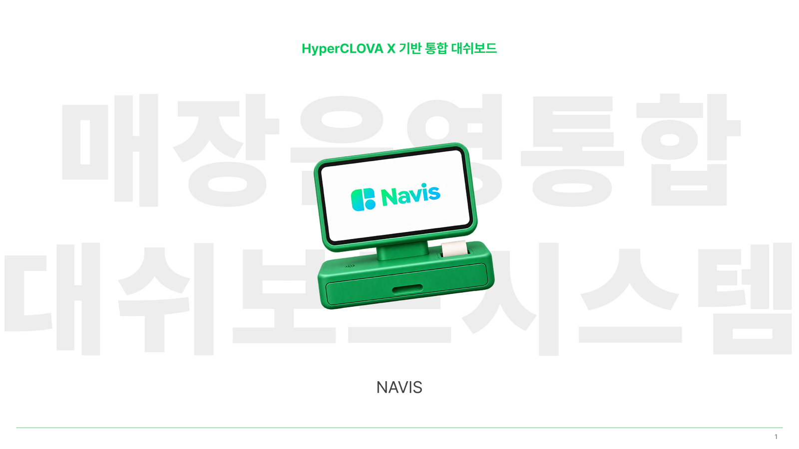
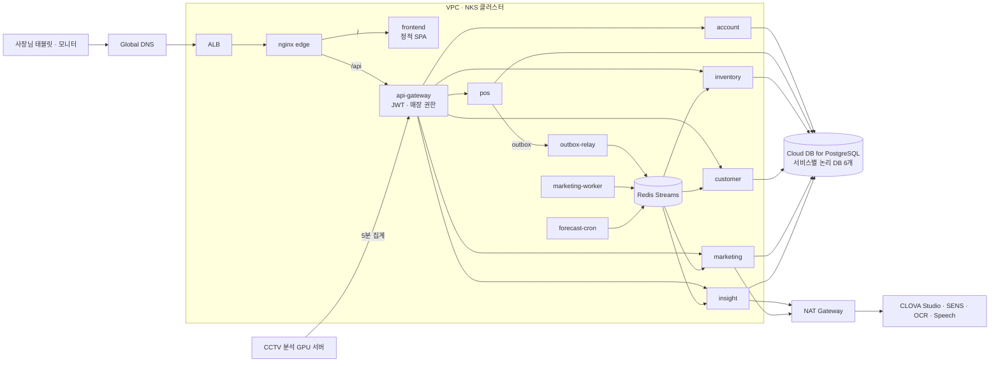
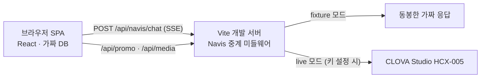

<div align="center">



# Navis

**HyperCLOVA X 기반 매장 운영 통합 대시보드**

주문·결제부터 재고, 손님, 마케팅까지 — 사장님이 필요한 것만 골라 한 화면에 모으고,<br/>
매장 AI 비서 **Navis**에게 말로 물어보는 소상공인용 운영 시스템

<br/>


</div>

<br/>

## 목차

1. [프로젝트 소개](#-프로젝트-소개)
2. [핵심 기능](#-핵심-기능)
3. [Navis AI 비서](#-navis-ai-비서)
4. [네이버 클라우드 활용](#-네이버-클라우드-활용)
5. [시스템 아키텍처](#-시스템-아키텍처)
6. [기술 스택](#-기술-스택)
7. [프로젝트 구조](#-프로젝트-구조)
8. [실행 방법](#-실행-방법)
9. [팀 소개](#-팀-소개)

<br/>

## 📌 프로젝트 소개

### 문제

작은 가게 사장님에게 필요한 정보는 여기저기 흩어져 있습니다.
매출은 POS에, 재고는 수첩에, 예약은 전화와 메신저에, 쿠폰과 리뷰는 각 플랫폼에 있습니다.
여러 화면을 오가며 숫자를 맞춰 보는 동안 정작 **"지금 우리 가게에 무슨 일이 일어나고 있는지"** 를 한눈에 보기 어렵습니다.

### 해결

Navis는 계산대 옆 태블릿·모니터에 세워 두는 **매장 운영 상황판**입니다.

| 특징 | 설명 |
| :--- | :--- |
| 🧩 **내가 만드는 대시보드** | 30개 위젯 중 필요한 것만 골라, 중요한 것은 크게·가벼운 것은 작게 직접 배치합니다. |
| 🔗 **한 숫자, 한 출처** | 주문·결제에서 생긴 거래가 손익·재고·회원·마감 정산에 같은 값으로 이어집니다. |
| 💬 **말로 묻는 AI 비서** | "어제 매출 얼마야?", "재고 위젯 추가해줘"처럼 말하면 Navis가 가게 자료로만 답하고 위젯을 놓아 줍니다. |
| 🎥 **눈으로 보는 매장** | CCTV 영상에서 자리별 이용 상태와 음료 대기 손님을 찾아 알려 줍니다. |

<br/>

## ✨ 핵심 기능

Navis는 세 개의 레이어로 나뉩니다. 왼쪽 위 메뉴로 언제든 오갈 수 있습니다.

### 🧾 주문/결제 (POS)
- 선불형(주문 화면)과 후불형(테이블 배치도) 매장을 모두 지원
- 주문 담기, 할인·쿠폰·회원 적립, 분할 결제, 취소·환불 영수증
- 테이블 이용 현황, 주문 현황, **마감 정산**(시재 확인·다시 열기)
- 결제 결과가 관리 위젯의 매출·재고·회원 숫자에 그대로 반영

### 📊 관리 (17개 위젯)
| 묶음 | 위젯 |
| :--- | :--- |
| 상품·재고 | 메뉴, 재고, 발주, 주문제작 |
| 재무 | 손익, 마진, 세무관리, 충전금·외상 관리, 정부지원 |
| 회원·손님 | 회원목록, 예약, CCTV 현황 |
| 매장 운영 | 캘린더, 직원 스케줄표, 매장 환경(온·습도·음악), 매뉴얼 작성, 브리핑 |

### 📣 마케팅 (13개 위젯)
| 묶음 | 위젯 |
| :--- | :--- |
| 동네·상권 | 동네 변화, 상권분석, 로컬 트렌드, 커뮤니티 |
| 쿠폰·단골 | 빈 시간 쿠폰, 마감 쿠폰, 쿠폰 현황, 단골 관리 |
| 홍보 | 오늘 할 홍보, **AI 홍보 영상**, AI 응답(리뷰·문의 답글), 공지 발송, 마케팅 성과 |

### 🖥️ 대시보드 경험
- **격자 배치**: 1×1부터 4×4까지 크기 조절, 끌어다 놓기·길게 눌러 옮기기, 겹치면 주변 위젯이 자연스럽게 비켜남
- **되돌리기**: 배치 변경은 언제든 되돌릴 수 있음
- **온보딩**: 업종 선택 → "카페 사장님이 많이 쓰는 위젯으로 시작하기"
- **출근·퇴근 브리핑**: 오늘 할 일과 어제 요약을 카드로
- **4개 언어**: 한국어 · English · 简体中文 · 繁體中文
- **라이트·다크 모드**, 글자 크기 조절, 키보드·스크린리더 접근성

<br/>

## 🤖 Navis AI 비서

Navis는 **CLOVA Studio HCX-005**를 사용하는 매장 전용 AI 비서입니다.
일반 챗봇과 달리, **가게 자료로 확인되는 것만 말하도록** 서버에서 강제합니다.

```text
사장님 질문 ─▶ 질문 관련 가게 자료만 추려서 전달 ─▶ HCX-005 (SSE 스트리밍)
                                                    │
         화면 ◀─ 문장 단위 검증 ◀────────────────────┘
          ├─ 숫자·날짜는 자료의 표시값과 일치할 때만 노출
          ├─ 매장과 무관한 질문은 고정 안내로 거절 (범위 판정)
          ├─ 지어낸 외부 업체·일반 조언·마크다운 기호 제거
          └─ 답이 끝난 뒤 검증된 위젯 후보 카드 표시
```

| 기능 | 설명 |
| :--- | :--- |
| 근거 기반 답변 | 숫자·날짜·이름·앱 경로가 가게 자료와 맞는 문장만 내보냄 |
| 이전 대화 기억 | 최근 3번의 대화를 요약해 이어 묻기("그럼 어제는?")를 이해 |
| 매장 범위 하네스 | 매장과 무관한 요청은 글 없이 고정 안내로 응답 |
| 말로 위젯 추가 | "재고 위젯 추가해줘" → 카드를 누를 때와 같은 동작으로 배치, 되돌리기 가능 |
| 확인 카드 실행 | 쿠폰 발송·영상 생성 같은 쓰기 작업은 사장님이 카드를 눌러야만 실행 |
| 음성·영수증 입력 | CLOVA Speech로 말해서 질문, 영수증 사진을 CLOVA OCR로 읽어 지출 입력 |

<br/>

## ☁️ 네이버 클라우드 활용

| 서비스 | 사용처 |
| :--- | :--- |
| **CLOVA Studio · HCX-005** | Navis 대화, 위젯 추천, 리뷰 답글·매뉴얼·정부지원 신청서 초안, 홍보 사진 분석 |
| **CLOVA Studio · HCX-007** | AI 홍보 영상의 대본·장면 구성 (Structured Outputs) |
| **CLOVA OCR (Receipt)** | 거래처 영수증 사진 → 지출 입력 제안 |
| **CLOVA Speech** | Navis 음성 질문 (짧은 문장 인식) |
| **SENS** | 공지·쿠폰 문자 발송 (승인된 테스트 번호만) |
| **NKS · NCR · ALB · VPC** | 서비스 배포 대상 인프라 (쿠버네티스) |
| **Cloud DB for PostgreSQL** | 서비스별 논리 DB 6개 |
| **Object Storage · Cloud Insight** | 홍보 영상·증빙 보관, 기본 모니터링 |

<br/>

## 🏗️ 시스템 아키텍처

### 배포 목표 구조 (NAVER Cloud Platform)



| 서비스 | 맡는 일 |
| :--- | :--- |
| `account` | 계정·매장·권한, JWT 발급, 대시보드 설정 |
| `pos` | 주문·결제·정정·시재·마감 (돈의 원장) |
| `inventory` | 메뉴·레시피·재고·발주·입고, 수요 예측 결과 |
| `customer` | 손님·회원권·예약·근무표 |
| `marketing` | 쿠폰·문자·홍보 영상 작업 |
| `insight` | Navis 대화, CCTV 집계, AI 사용량 기록 |

서비스끼리는 직접 DB를 공유하지 않고, **outbox 패턴 + Redis Streams** 이벤트로 결과를 전달합니다.
배포는 GitHub Actions → Container Registry → `helm upgrade` 흐름을 목표로 합니다.

### 현재 저장소의 실행 구조



<br/>

## 🛠️ 기술 스택

| 영역 | 기술 |
| :--- | :--- |
| **Frontend** | React 19, TypeScript 5.9, Vite 8, Zustand, Base UI, dnd-kit, Motion, Recharts, Sonner |
| **AI 중계 서버** | Node.js 내장 fetch · SSE, CLOVA Studio native v3 API |
| **Backend** | Node.js 24, Fastify 5, PostgreSQL 17, node-pg-migrate, Redis Streams, ES256 JWT, Row Level Security |
| **CCTV 분석** | Python, FastAPI, YOLO11s, ByteTrack, PyTorch (CUDA) |
| **Infra** | NAVER Cloud NKS, Container Registry, ALB, Cloud DB for PostgreSQL, Object Storage, Docker Compose |
| **Test** | Vitest, Testing Library, Node test runner, Playwright |

<br/>

## 📁 프로젝트 구조

```text
Navis/
├── frontend/                  # 웹 앱 (React SPA + 개발 서버의 AI 중계)
│   ├── src/
│   │   ├── app/               # 앱 셸, 레이어 전환, 세션·실행 상태 연결
│   │   ├── screens/           # 화면 단위: 대시보드, 상세 보기, 주문/결제, 온보딩, 브리핑, 설정
│   │   ├── features/
│   │   │   ├── widgets/       # 관리·마케팅 위젯 30개 (패널 + 자세히 보기)
│   │   │   ├── assistant/     # Navis 대화창, 질문 해석, 제안 카드, 음성 입력
│   │   │   └── cctv/          # CCTV 영상 재생, 실시간 연결, 테이블 구역 편집
│   │   ├── data/              # 브라우저 안의 가짜 DB, 위젯 모델, 데이터 명령
│   │   ├── pos/               # 결제 원장·정산·마감·적립 도메인 로직
│   │   ├── layout/            # 격자 배치 엔진 (Web Worker에서 계산)
│   │   ├── catalog/           # 위젯 등록부와 업종별 시작 템플릿
│   │   ├── contracts/         # 화면·데이터·POS가 공유하는 타입 계약
│   │   ├── state/             # 실행 상태(RunStore)와 되돌리기
│   │   ├── ui/                # 디자인 토큰, 공용 컴포넌트, 모션, 접근성
│   │   └── i18n/              # 4개 언어 번역 엔진과 포맷터
│   ├── server/
│   │   ├── bridge.mjs         # Navis 대화 중계: 검증·근거 확인·SSE 스트리밍
│   │   ├── clova-studio.mjs   # CLOVA Studio HCX-005 클라이언트
│   │   ├── navis/             # 도메인별 Navis 도구 (메뉴·재고·예약·쿠폰 등)
│   │   ├── promo/             # AI 홍보 영상 파이프라인 (대본 → 장면 → 녹화)
│   │   ├── media/             # 영수증 OCR·음성 인식 중계
│   │   └── widget-drafts.mjs  # 답글·매뉴얼·신청서 초안과 테스트 문자
│   ├── shared/                # 서버와 화면이 함께 쓰는 Navis 도구 스키마
│   ├── scripts/               # 시드 생성·서버 시험 실행 스크립트
│   └── public/                # 메뉴 사진, CCTV 예시 탐지 결과
├── backend/                   # 서버 (MSA)
│   ├── gateway/               # API gateway: JWT 검증, 매장 권한, 내부 서비스 전달
│   ├── services/              # account · pos · inventory · customer · marketing · insight
│   ├── workers/               # 입고 영수증 소비, 마케팅 작업기, 수요 예측 크론
│   ├── relay/                 # outbox → Redis Streams 이벤트 전달
│   ├── packages/              # 공용 계약 타입, DB 접속·마이그레이션, 이벤트 스트림
│   ├── infra/                 # nginx edge, PostgreSQL 초기화, 로컬 비밀값 생성
│   ├── deploy/                # NKS 배포 샘플 (Helm 차트, GitHub Actions 예시)
│   └── compose.yaml           # 로컬 실행 (Docker Compose)
├── cnn/                       # CCTV 영상 분석 (YOLO11s + ByteTrack)
│   ├── live/                  # 실시간 분석 서버 (FastAPI, WebSocket, 휴대폰 카메라 페이지)
│   ├── occupancy/             # 자리 사용·앉음 판정
│   └── bench/                 # GPU·CPU·INT8 속도와 정확도 측정
├── db/seed/                   # 가상 카페 '안숭잘부'의 90일 운영 시드 생성기
└── docs/images/               # README 이미지
```

> 폴더별 자세한 설명은 [`frontend/README.md`](frontend/README.md), [`backend/README.md`](backend/README.md), [`cnn/README.md`](cnn/README.md)에 있습니다.

<br/>

## 🚀 실행 방법

**요구 사항**: Node.js 20.20 이상

```bash
cd frontend
npm ci
npm run dev          # http://127.0.0.1:5173
```

API 키 없이도 모든 화면이 동작합니다. Navis 챗봇은 동봉한 가짜 응답(fixture 모드)으로 답합니다.
실제 HyperCLOVA X를 연결하려면 예시 파일을 복사해 키를 넣습니다.

```bash
cp .env.local.example .env.local   # {sample: ...} 값을 실제 값으로 교체
```

**검사**

```bash
npm run typecheck    # 타입 검사
npm run test:unit    # 화면·데이터 단위 시험 (Vitest)
npm run test:server  # Navis 중계·홍보 영상 서버 시험 (Node test runner)
npm run build        # 배포용 빌드
```

<br/>

## 👥 팀 소개

<table>
  <tr>
    <td align="center" width="25%">
      <br/>
      <b>구정현</b><br/>
      <sub>AI · 프론트엔드</sub>
    </td>
    <td align="center" width="25%">
      <br/>
      <b>권나현</b><br/>
      <sub>팀장서비스 · 기획 · UX</sub>
    </td>
    <td align="center" width="25%">
      <br/>
      <b>이민우</b><br/>
      <sub>기능 기획 · 데이터</sub>
    </td>
    <td align="center" width="25%">
      <br/>
      <b>백준규</b><br/>
      <sub>백엔드 · 인프라</sub>
    </td>
  </tr>
  <tr>
    <td valign="top">
      <sub>
      · 프로젝트 총괄과 일정 관리<br/>
      · Navis AI 비서 설계와 HyperCLOVA X 연동<br/>
      · 대시보드·위젯 프론트엔드<br/>
      · CCTV 분석 연동
      </sub>
    </td>
    <td valign="top">
      <sub>
      · 주문/결제(POS) 레이어 기획<br/>
      · 관리 대시보드 구성과 위젯 정의<br/>
      · 화면 흐름과 사용성 검토
      </sub>
    </td>
    <td valign="top">
      <sub>
      · 위젯 기능 상세 기획<br/>
      · 위젯·AI가 쓰는 데이터 정의<br/>
      · 시나리오와 시연 데이터 검토
      </sub>
    </td>
    <td valign="top">
      <sub>
      · MSA 서비스 구조와 API 설계<br/>
      · ERD·PostgreSQL DB 설계<br/>
      · NAVER Cloud(NKS) 인프라 설계
      </sub>
    </td>
  </tr>
</table>

<br/>

<div align="center">
<sub>© 2026 Team Navis · HyperCLOVA X 기반 매장 운영 통합 대시보드</sub>
</div>
